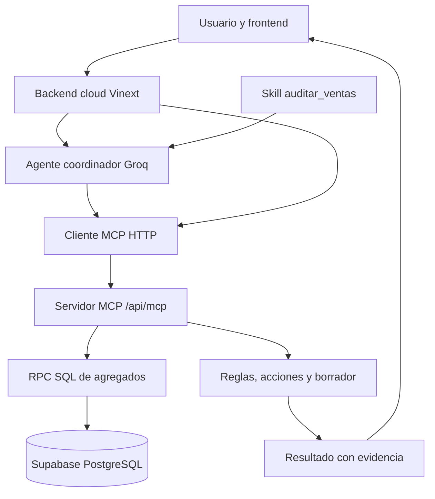

# Arquitectura del auditor

El coordinador consulta el catálogo MCP y selecciona herramientas. Máximo 5 pasos y 8 llamadas. Skill real cargada como instrucciones; procedimientos implementados en audit.mjs y migraciones SQL. MCP Streamable HTTP validado con ClientSession del SDK oficial. No se requiere plugin Sites registrado para este endpoint directo.

Herramientas: resumen_ventas, comparar_grupos, comprobar_calidad, auditar_anomalias, redactar_borrador y estimar_escenario. Los resultados de auditoría y borradores se presentan desde evidencia estructurada para evitar cifras/umbrales añadidos al redactar. El modelo sigue eligiendo herramientas y parámetros.

## Detección, diagnóstico y acción
Detección recorre TODOS los grupos; ranking visual solo enseña top8. Diagnóstico distingue señal y causa no demostrada. Acción propone conciliación, responsable y validación; genera un borrador descargable. No envía emails ni cambia políticas.

Automatización: carga inicial y cada 60 segundos con página visible; se puede desactivar. No hay cron, vigilancia con navegador cerrado ni ingesta automática externa. Cada consulta relee Supabase. El dataset actual es histórico.

Escenario: coste supuesto por el usuario sobre ventas positivas, no recuperado al cancelar. Resultado estimado = neto − coste supuesto. Margen estimado = resultado/neto cuando neto>0. Sin impuestos/gastos fijos. No beneficio real.

## Fallos y límites
Validación de parámetros422; fallos externos503; cuota Groq429 con mensaje. Panel, auditoría y borradores no necesitan Groq. RLS protege filas crudas. SQL fijo y funciones de lectura; claves solo en servidor. Cualquier ejecución de políticas comerciales o envío requeriría una función nueva y revisión humana. Sin prueba de carga: no afirmar disponibilidad ilimitada.

Alternativa local: FastAPI → Groq/Ollama → SDK MCP stdio → PostgreSQL. Requiere Python3.13, dependencias fijadas y .env local. Código cloud y Python se documentan por separado para no confundir sus transportes.
